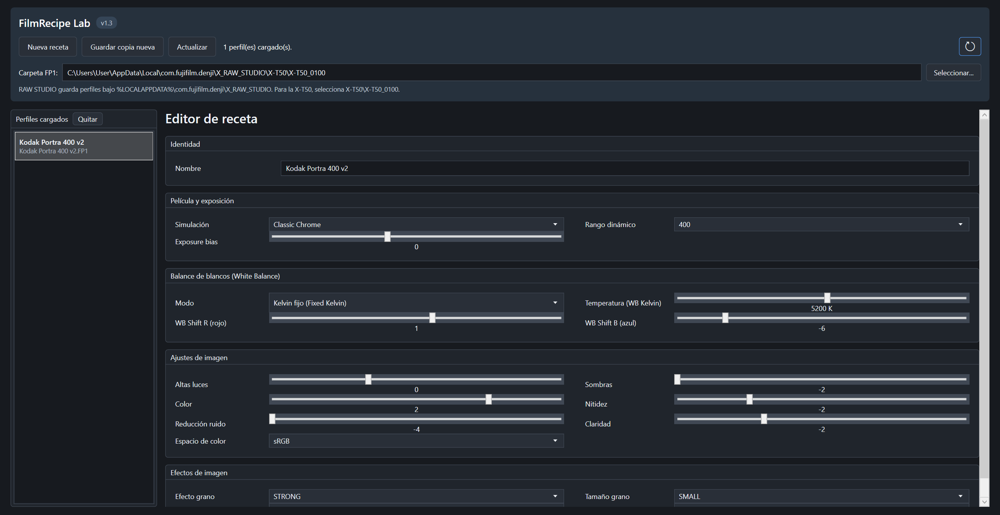

# FilmRecipe Lab

Aplicación de escritorio para Windows 11 destinada a gestionar, editar y exportar recetas de la Fujifilm X-T50 almacenadas en perfiles `.FP1` de Fujifilm RAW Studio.

**Versión actual: 1.3**

El proyecto está limitado intencionadamente a la X-T50. No busca soportar otras cámaras Fujifilm.

## Estado actual

- Aplicación WPF sobre C#/.NET 8 con tema oscuro.
- Lectura de uno o varios perfiles `.FP1`.
- Modelo tipado específico para los parámetros editables de la X-T50.
- Creación de recetas X-T50 desde cero con valores iniciales listos para editar.
- Exportación a `.FP1` conservando metadatos y propiedades XML desconocidas.
- XML generado validado manualmente en Fujifilm RAW Studio.
- Carpeta configurable que se carga automáticamente al iniciar la aplicación.
- Ruta predeterminada de RAW STUDIO: `%LOCALAPPDATA%\com.fujifilm.denji\X_RAW_STUDIO\X-T50\X-T50_0100`.
- Recarga manual de perfiles externos mediante el botón con icono de actualizar.
- Edición visual mediante controles deslizantes y campos opcionales.
- Balance de blancos agrupado con temperatura Kelvin y desplazamientos `WB Shift R` y `WB Shift B`.
- `Temperature` se muestra como `Kelvin fijo (Fixed Kelvin)` para asociarlo con recetas externas.
- Controles para `Color Chrome FX` y `Color Chrome FX Blue`, con niveles `OFF`, `WEAK` y `STRONG`.
- `ExposureBias` mostrado como fracciones como `1/3`, `2/3` o `1 1/3`, mientras se conserva internamente como valor decimal.
- Lista que muestra nombre y archivo `.FP1` asociado.
- Marca azul en las recetas con cambios pendientes de actualizar o guardar.
- `Guardar copia nueva` crea un archivo nuevo sin modificar el original.
- `Actualizar` sobrescribe el archivo seleccionado, previa confirmación.
- `Quitar` y `Supr` eliminan el archivo seleccionado, previa confirmación.

## Vista Previa



## Uso

1. Abre la aplicación desde VS Code con `F5` o ejecuta `dotnet run --project src/FilmRecipeLab.Presentation`.
2. Si es la primera ejecución y existe la carpeta RAW STUDIO de la X-T50, se usa y escanea automáticamente.
3. Para otra ubicación, usa `Seleccionar...` y elige la carpeta que contenga los `.FP1`.
4. Pulsa `Nueva receta` para empezar desde cero aunque la carpeta esté vacía, o selecciona un perfil existente.
5. Edita sus valores y usa `Recargar` después de realizar cambios fuera de la aplicación.
6. Usa `Guardar copia nueva` para crear el primer `.FP1` de un borrador o conservar el original de un perfil cargado.
7. Usa `Actualizar` para sobrescribir un `.FP1` existente después de confirmar.

## Estructura

```text
src/
  FilmRecipeLab.Domain/          Modelo XT50Recipe y reglas del dominio
  FilmRecipeLab.Application/    Casos de uso y contratos de servicios
  FilmRecipeLab.Infrastructure/ Lectura y escritura FP1
  FilmRecipeLab.Presentation/   Aplicación WPF, vistas y ViewModels

tests/
  FilmRecipeLab.Tests/           Pruebas de lectura, escritura y conversión

Resources/
  DemoFile.FP1                   Perfil de referencia publicado

.vscode/
  launch.json                    Configuración de ejecución y depuración
  tasks.json                     Tareas de compilación, pruebas y publicación

Resources/
  ReleaseNotes.md                Notas por versión para las releases de GitHub

publish/
  FilmRecipeLab/
    FilmRecipeLab.exe            Ejecutable Release autónomo para Windows x64
```

## Comandos

```powershell
dotnet build FilmRecipeLab.sln
dotnet test FilmRecipeLab.sln
dotnet run --project src/FilmRecipeLab.Presentation
```

Desde VS Code también están disponibles las configuraciones `FilmRecipeLab: ejecutar WPF` y `FilmRecipeLab: ejecutar con dotnet` desde el panel Run and Debug.

## Crear el ejecutable

La aplicación se publica como un único ejecutable autónomo para Windows x64.

Desde VS Code:

1. Pulsa `Ctrl+Shift+P`.
2. Ejecuta `Tasks: Run Task`.
3. Selecciona `FilmRecipeLab: publicar EXE Release`.

También puedes usar el menú `Terminal > Run Task`.

La publicación se genera en:

```text
publish/FilmRecipeLab/FilmRecipeLab.exe
```

Este ejecutable incluye el runtime necesario y puede ejecutarse directamente en Windows 11 sin usar `dotnet run`. La carpeta `publish/` está excluida de Git.

Para publicar desde PowerShell:

```powershell
dotnet publish src/FilmRecipeLab.Presentation/FilmRecipeLab.Presentation.csproj -c Release -r win-x64 --self-contained true -p:PublishSingleFile=true -p:IncludeNativeLibrariesForSelfExtract=true -o publish/FilmRecipeLab
```

## Crear una release desde GitHub

1. Añade en `Resources/ReleaseNotes.md` un apartado `## X.Y` con los cambios de esa versión.
2. Abre la pestaña **Actions** del repositorio y selecciona **Crear release**.
3. Pulsa **Run workflow**, elige la rama y escribe la versión sin prefijo `v` (por ejemplo, `1.3`).
4. Pulsa **Run workflow** para ejecutar las pruebas, publicar el ejecutable autónomo y crear una release con la etiqueta `v1.3`.

El body de cada release se extrae de su sección correspondiente en `Resources/ReleaseNotes.md`; si no existe o está vacía, el workflow falla antes de crear la release. El archivo `FilmRecipeLab.exe` quedará adjunto. Usa una sección y una versión nuevas para cada publicación.

## Alcance pendiente

- Interfaz para importar recetas desde capturas mediante OCR.
- Compatibilidad con cámaras Fujifilm distintas de la X-T50.

## Seguridad y conservación de datos

- La lectura no modifica archivos existentes.
- `Guardar copia nueva` evita sobrescribir el perfil original.
- `Actualizar` pide confirmación antes de sobrescribir.
- `Quitar` pide confirmación antes de borrar el `.FP1`.
- Los campos desconocidos siguen conservándose durante la exportación.

